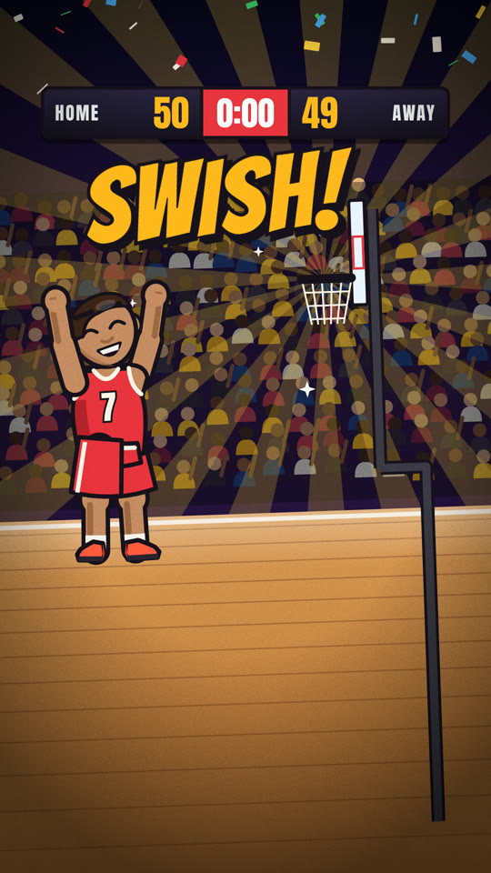
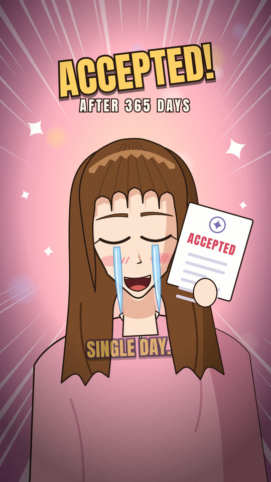
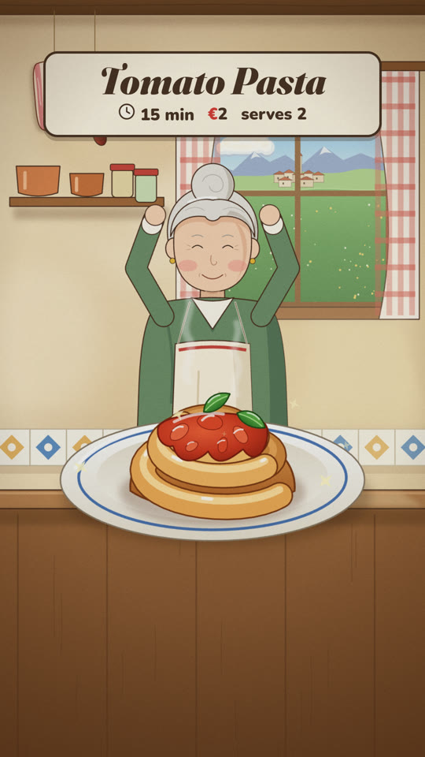

# cartoon-shorts

A Claude Code skill that makes animated cartoon shorts for **YouTube Shorts, TikTok and Instagram Reels**:
9:16, 15 to 90 seconds, with voice-over, music, sound effects and big captions, rendered locally to an MP4,
plus the title, description, captions and covers for each platform.

Everything is drawn in code (SVG and HTML). No image or video models, no stock footage, nothing to license:
the music and effects are synthesized too.

| comic | anime | manga | paper | painted |
|---|---|---|---|---|
|  |  |  |  |  |

## How it works

1. **It interviews you first.** Topic, one video or a series, goal and tone, audience and language,
   platforms, length, visual style (with the gallery above), narrator, voice, ending. Nothing gets drawn
   before the brief is clear.
2. **Research and facts.** If the video states facts, it checks them and keeps the sources for the description.
3. **Story.** For longer videos it drafts two or three structures (hook, thread, payoff) and you pick one.
   Then a line-by-line script with captions and delivery notes for the voice. You approve it.
4. **Look test.** It builds the opening scene and shows you test frames before building the rest.
5. **Build, voice, check.** Every animation is keyed to the voice lines, so re-voicing a line moves the
   visuals with it. A contact sheet of the whole video is checked for safe areas and pacing.
6. **Render and kit.** A master-quality MP4 (PNG frames, x264 CRF 10, BT.709, AAC set to 320 kb/s) and a `post/` folder
   with the texts and covers for each platform. Uploading stays with you.

## Install

Requirements: [Claude Code](https://claude.com/claude-code), Node 22+, Python 3.9+ with numpy
(`python3 -m pip install numpy`; if pip refuses with "externally-managed-environment", make a venv:
`python3 -m venv ~/.venvs/shorts && ~/.venvs/shorts/bin/pip install numpy` and use that `python3`), ffmpeg,
Google Chrome or Chromium. No npm packages.

```bash
git clone https://github.com/Matteoikarieth96/cartoon-shorts-skill ~/.claude/skills/cartoon-shorts
python3 ~/.claude/skills/cartoon-shorts/scripts/doctor.py
```

## Usage

Ask Claude Code, for example:

> Make a 45-second cartoon short about how the first lighthouse keepers lived, for TikTok and Reels.

> Fammi un reel animato con la ricetta della carbonara, stile cartone caldo e dipinto.

## Voices

| Voice | Cost | Setup |
|---|---|---|
| OpenAI `gpt-4o-mini-tts` (best: per-line acting notes, accents) | about 1.5 US cents per minute ([pricing](https://openai.com/api/pricing/)) | `OPENAI_API_KEY=...` in the series folder's `.env` |
| macOS voices | free | built in (`say`) |
| espeak-ng (Linux) | free | `sudo apt install espeak-ng` |
| Your own recordings | free | one file per line in `rec/` (`line_00.wav`, ...) |

Keys stay in a local, git-ignored `.env` and are only sent to OpenAI.
With an OpenAI voice, the script lines (and, for the optional `check_voice.py`, the voice clips) are sent to OpenAI;
nothing else leaves your machine except the Google Fonts request of the page. OpenAI voices are AI-generated:
with one, the kit adds an "AI-generated voice" line to the texts and turns the AI labels on in the checklist.
The voice is always your choice: the skill asks, and OpenAI is never used unless you pick it.

## Use the engine without Claude

```bash
S=~/.claude/skills/cartoon-shorts
python3 $S/scripts/new_episode.py my-series first-episode --styles painted --voice say
cd my-series
# edit episodes/first-episode/short.json (what is said) and scenes.js (what is drawn)
python3 engine/audio.py episodes/first-episode           # voice, timeline, music, effects, mix
node engine/render.mjs episodes/first-episode sheet 1.5  # contact sheet in stills/sheet.png
node engine/render.mjs episodes/first-episode full       # out/first-episode.mp4
python3 engine/kit.py episodes/first-episode             # post/ for YouTube, TikTok, Instagram
```

Each style has a guide in `references/styles/` and a short working episode in `examples/`.
The engine API is in `references/engine-api.md`.

## Notes

- Characters are original drawings. The skill does not copy characters, logos or symbols from existing
  shows, studios or brands, and it draws real people only as respectful caricatures backed by sourced facts.
- Rendering a 60 s video took about 1 to 3 minutes on an Apple M1 Max laptop (4 Chrome workers).
- Tested on macOS (all voices) and Ubuntu in CI (espeak-ng and recordings). Windows is untested.
- Fonts come from Google Fonts at render time (internet needed the first time).

## Security

The engine runs only local tools (Python, Node, Chrome, ffmpeg) on files inside your series folder, calls OpenAI
only when you choose an OpenAI voice, and never uploads or posts anything. Episode pages are JavaScript: render
only episodes you or Claude wrote; text from research is escaped before it goes on screen. Details and how to report a problem: [SECURITY.md](SECURITY.md).

## Tests

```bash
python3 -m unittest discover -s tests -v
```
The pipeline tests (voice from generated tones, music, render, upload kit) run when numpy, ffmpeg, Node 22+ and
Chrome are installed, and are skipped otherwise: look for `skipped` in the summary (`REQUIRE_PIPELINE=1` turns a
skip into a failure).

## More skills

- [whiteboard-video](https://github.com/Matteoikarieth96/whiteboard-video-skill): hand-drawn whiteboard explainer videos with voice-over
- [evm-dd](https://github.com/Matteoikarieth96/evm-dd-skill): investor-angle due diligence on crypto and EVM projects, with a scored report and an A4 one-pager
- [hiring-prep](https://github.com/Matteoikarieth96/hiring-prep-skill): an interview prep page from a company, a role and your resume, with an interactive test
- [3d-print-design](https://github.com/Matteoikarieth96/3d-print-design-skill): parametric parts for FDM 3D printing, checked before export
- [skill-release](https://github.com/Matteoikarieth96/skill-release-skill): publish a skill as a public GitHub repo without leaking anything, with an automated scan and independent review
- [adversarial-review](https://github.com/Matteoikarieth96/adversarial-review-skill): a panel of independent reviewer agents challenges finished work and returns one verdict
- [breadboard-wiring-guide](https://github.com/Matteoikarieth96/breadboard-wiring-guide-skill): step-by-step breadboard wiring for Arduino UNO, with a diagram and a USB call on every step
- [token-checkup](https://github.com/Matteoikarieth96/token-checkup-skill): a weekly token checkup for Claude Code: session size, what loads at session start, memory kept true
- [portfolio-report](https://github.com/Matteoikarieth96/portfolio-report-skill): an English portfolio report and A4 one-pager from a Fineco export, with a switch to hide the amounts
- [beer-can-label](https://github.com/Matteoikarieth96/beer-can-label-skill): a print-ready beer can label with a 3D can preview
- [claude-time-is-relative](https://github.com/Matteoikarieth96/claude-time-is-relative): time estimates for Claude Code tasks, learned from your own past sessions
- [ai-privacy-check](https://github.com/Matteoikarieth96/ai-privacy-check-skill): a first privacy and AI rules check for a concrete use case in Italy and the EU (in Italian)

## License

MIT. See [LICENSE](LICENSE).

Independent project, not affiliated with or endorsed by YouTube, Google, TikTok, Instagram, Meta, OpenAI or Anthropic.
